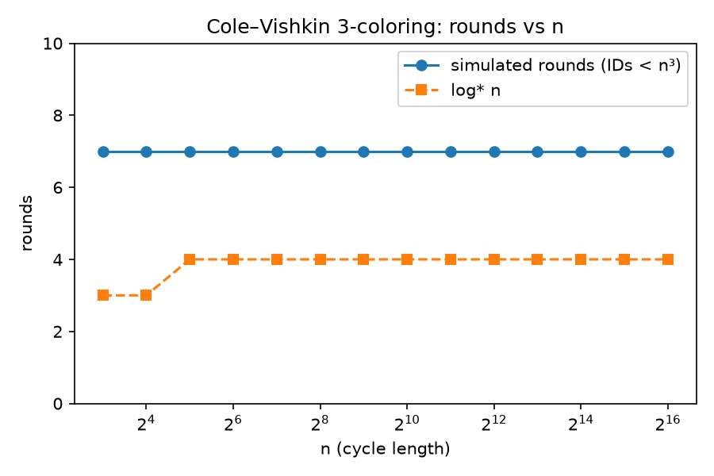
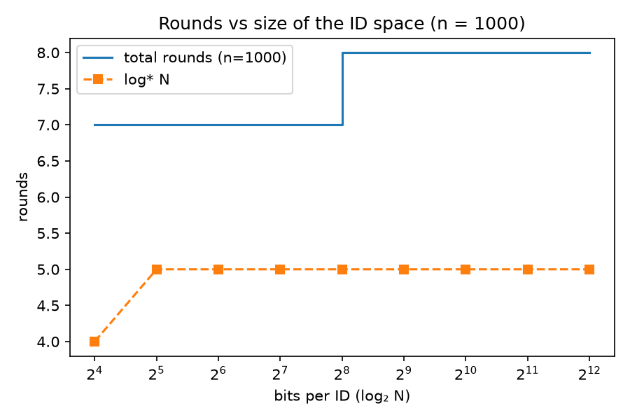

# Symmetry Breaking on Cycles: a LOCAL-Model Simulator

A small, object-oriented Python simulator of the synchronous **LOCAL model** on cycle graphs, used to
check two classical facts empirically:

1. With unique IDs, a cycle can be properly **3-colored in Θ(log\* n) rounds** (Cole–Vishkin + greedy clean-up).
2. On a completely **anonymous** cycle, no deterministic algorithm can break symmetry, however many rounds it runs.

```
node.py        Node: one agent; only sees messages in its inboxes
network.py     CycleNetwork: builds the cycle, delivers messages, runs the algorithm, tracks metrics
validator.py   Input checks + proper-coloring verification
utils.py       Tiny shared helper (bit-cost of a value), used by both node.py and network.py
experiments.py Runs all experiments, writes results/*.csv and results/*.png
tests/         Unit tests (python -m unittest discover -s tests)
results/       Output of the last run (csv, png, console log)
setup.cfg      flake8 configuration
requirements.txt, LICENSE, .gitignore
```

## Quick start

```bash
pip install -r requirements.txt
python -m unittest discover -s tests     # 11 tests
python experiments.py                    # regenerates everything in results/
```

```python
from network import CycleNetwork
net = CycleNetwork(1000, id_space=1000**3, seed=42)
print(net.execute_simulation(), "rounds")   # 7
print(net.colors[:10], net.message_complexity)
```

## Model and assumptions

* **Synchronous rounds.** In each round every node receives messages, then computes. One round = one step of communication.
* **Oriented cycle.** Node *i*'s successor is node *i+1 mod n*, and each node can tell its successor port from its
  predecessor port. Cole–Vishkin uses this orientation (a node only reads its successor's color).
* **IDs.** Nodes have unique IDs drawn from {0, …, N−1} with N ≥ n (default N = n³). Every node knows N.
* **No global control.** The stopping schedule is computed from N alone (`cole_vishkin_palette_schedule`),
  so all nodes agree on when each phase ends without inspecting the network. Nodes never see the network object.
* **Unbounded local computation and message size** (standard LOCAL model), but we still *measure* bits sent.

## Algorithm

1. **Cole–Vishkin reduction.** Each node compares its color with its successor's, finds the lowest bit *i* where they
   differ, and adopts the new color `2i + b` (b = its own bit at position *i*). Colors stay proper, and a palette of
   *k*-bit colors shrinks to fewer than 2k colors. Iterating from N colors reaches a palette of size ≤ 6.
2. **Greedy clean-up.** For colors 5, 4, 3 (one round each), every node holding that color picks the smallest value in
   {0,1,2} not used by its two neighbors. Nodes with equal colors are never adjacent, so this is safe in parallel.

`execute_simulation()` ends by verifying the result is a proper coloring with ≤ 3 colors and raises if not.

## Results

### 1. Rounds vs n (IDs from {0..n³−1}, 5 random ID assignments per n)

| n | log\* n | rounds | messages | peak per-node state (bits) |
|---|---|---|---|---|
| 2³ | 3 | 7 | 80 | 18 |
| 2⁸ | 4 | 7 | 2,560 | 48 |
| 2¹² | 4 | 7 | 40,960 | 72 |
| 2¹⁶ | 4 | 7 | 655,360 | 96 |



* **Rounds are constant (7) across all tested n**: 4 Cole–Vishkin rounds + 3 greedy rounds. This is what Θ(log\* n) looks like in practice, since
  log\* n ≤ 5 for every n that fits in memory. The full table is in `results/exp1_scaling.csv`.
* **Messages** are exactly n per Cole–Vishkin round and 2n per greedy round, so total = n·(4) + 2n·(3) = 10n, linear in n.
  Per node this is constant.
* **Peak state** is 2 × bits(N−1) bits — twice the bits needed to write the largest possible ID (own color
  plus the successor's color in round 1). Since `exp1_scaling` always uses N = n³ with n a power of two,
  N itself is a power of two there, so this happens to equal exactly 2·log₂(N) in the results table below.
  For a general N it's 2·⌈log₂N⌉, not log₂N exactly.

### 2. Rounds vs size of the ID space (n = 1000 fixed)

| bits per ID | log\* N | CV rounds | total rounds |
|---|---|---|---|
| 16 | 4 | 4 | 7 |
| 128 | 5 | 4 | 7 |
| 256 | 5 | 5 | 8 |
| 4096 | 5 | 5 | 8 |



Going from 16-bit to 4096-bit IDs (an astronomically larger space) costs one extra round. The round count follows
log\* N up to an additive constant, which is the expected shape.

### 3. Anonymous cycles: symmetry cannot be broken

* **Random deterministic rules.** For n ∈ {3, 10, 100, 1000} and 1, 5, 20 rounds, 300 random deterministic
  transition functions each (3,600 runs total): **in every run all nodes ended in the same state, and 0 runs produced a proper coloring.**
  (`results/exp3_anonymous.csv`)
* **Views.** On a 60-node cycle, the number of distinct radius-r views is **1 for anonymous nodes at every radius** (0, 1, 2, 5, 10)
  and **60 with unique IDs**. Nodes that cannot be told apart by their views must output the same thing. (`results/exp3_views.csv`)
* **Cole–Vishkin** on an anonymous cycle fails immediately with `SymmetryBreakingError`: there is no bit in which a node differs from its successor.

**Why (the classical argument).** If all nodes start in the same state, then by induction they still share one state after every
round: each node receives the same pair of messages (both neighbors are in the same state as everyone else) and applies the same
deterministic function. So all nodes output the same color, and any edge is monochromatic. The experiment above is a check of
this induction, not a replacement for it.

## What this does and does not show

* It confirms the **upper bound** O(log\* n) by running an algorithm; a simulation of one algorithm cannot prove Linial's
  Ω(log\* n) **lower bound**. What we show for the lower-bound side is the mechanism behind such arguments: what a node can
  distinguish is limited by its radius-r view (experiment 3, views).
* Sizes are limited by memory, and log\* grows so slowly that all practical cases land on 7–8 rounds.
* The cycle is oriented; the unoriented case needs a different algorithm.
* Only deterministic algorithms are covered; randomized and other models are out of scope.

